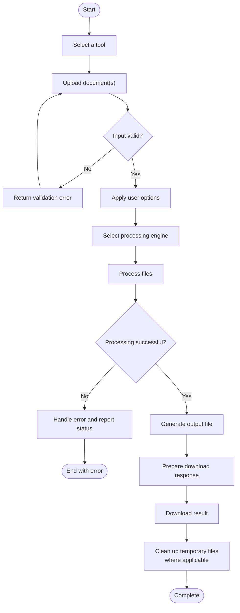
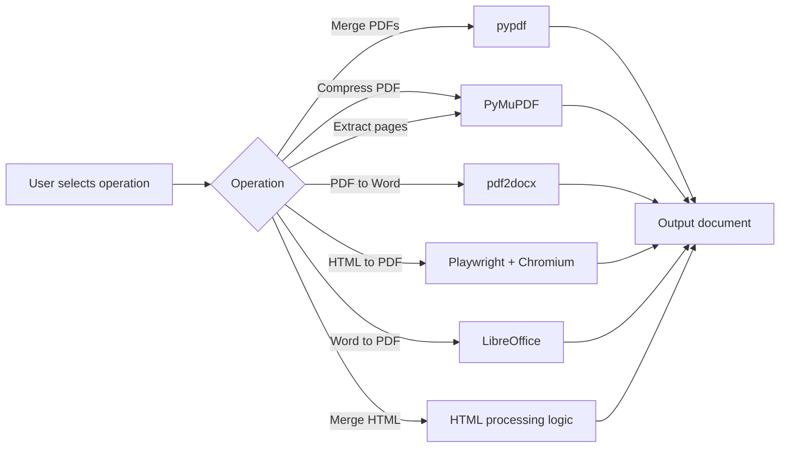

# PDF ToolKit — Personal File Utilities

A lightweight, locally hosted web application for merging, compressing, extracting, and converting PDF files, along with merging HTML documents. Built with Python and Flask, it brings everyday document-processing scripts into a simple browser-based interface.

**Process your files locally, configure your operations, and download the results directly from the interface.**

## ✨ Features

| Feature | Description |
|---|---|
| **PDF Merger** | Combine multiple PDF documents into a single file with customizable page order. |
| **HTML Merger** | Merge HTML files from individual uploads or ZIP archives, with natural, date-based, and manual sorting options. |
| **HTML to PDF Converter** | Convert HTML files and ZIP archives containing HTML documents and supporting assets into PDFs. |
| **PDF Compressor** | Reduce PDF file sizes using raster-based compression or lossless optimization. |
| **PDF Page Extractor** | Extract specific pages or page ranges into a separate PDF document. |
| **PDF to Word Converter** | Convert PDF documents into editable Microsoft Word (DOCX) files. |
| **Word to PDF Converter** | Convert Word and supported OpenDocument files into PDFs using LibreOffice.</text>
### 🖥️ User Interface

- Browser-based interface built with Flask and HTML, CSS, and JavaScript.
- Drag-and-drop file uploads.
- File ordering and removal controls.
- Configurable processing options.
- Download links for generated files.
- Live display of temporary workspace disk usage.
- Light and dark appearance based on system preferences.

## 🛠️ Technology Stack

| Technology | Purpose |
|---|---|
| Python | Application logic and file processing |
| Flask | Web server and API endpoints |
| PyMuPDF | PDF compression and page extraction |
| pypdf | PDF merging |
| pdf2docx | PDF-to-Word conversion |
| Playwright | Chromium-based HTML-to-PDF rendering |
| LibreOffice | Word-to-PDF conversion |
| HTML, CSS, JavaScript | Browser interface |


## 🏗️ Architecture

### 1. System Architecture

The application follows a modular, locally hosted architecture. Users interact with a browser-based interface, while Flask handles requests and coordinates document-processing libraries.


### 2. Document Processing Workflow

Each operation follows a common lifecycle: receive the uploaded files, validate the request, execute the selected operation, and return the generated document.



### 3. Processing Engine Selection



### Design Principles

- **Separation of concerns:** The browser interface handles user interaction, while Flask coordinates file processing.
- **Specialized processing engines:** Each document operation uses a library or external tool suited to that task.
- **Temporary file handling:** Intermediate and generated files use a workspace where required.
- **Local execution:** The application is intended to run on the user's machine rather than requiring a hosted document-processing service.
```
## 🚀 Getting Started

### Prerequisites

Install the following before running the application:

- Python 3.10 or newer recommended.
- pip, Python's package installer.
- Chromium dependencies installed through Playwright for HTML-to-PDF conversion.
- LibreOffice for Word-to-PDF conversion.

### 1. Clone the repository

```bash
git clone https://github.com/aarnav2425/PDF-ToolKit.git
cd PDF-ToolKit
```

### 2. Create a virtual environment

**macOS / Linux**

```bash
python3 -m venv .venv
source .venv/bin/activate
```

**Windows**

```powershell
python -m venv .venv
.venv\Scripts\activate
```

### 3. Install dependencies

```bash
python -m pip install --upgrade pip
pip install -r requirements.txt
```

### 4. Install the Playwright browser

Required for HTML-to-PDF conversion:

```bash
python -m playwright install chromium
```

### 5. Install LibreOffice

Word-to-PDF conversion requires LibreOffice to be installed and discoverable by the application.

- **macOS:** Install LibreOffice and ensure its executable is discoverable.
- **Windows:** Install LibreOffice and ensure `soffice.exe` is available.
- **Linux:** Install LibreOffice using your distribution's package manager.

### 6. Start the application

```bash
python app.py
```

Open the following address in your browser:

**http://localhost:5000**

Keep the terminal running while you use the application.

## 📖 How to Use

1. Start the Flask application.
2. Open `http://localhost:5000`.
3. Select the required tool from the navigation menu.
4. Upload your files by dragging them into the upload area or browsing your computer.
5. Configure any available options, such as compression mode, page ranges, or file ordering.
6. Run the operation and wait for processing to finish.
7. Download the generated file.

### Example: Merge PDFs

1. Select **Merge PDFs**.
2. Upload two or more PDF files.
3. Choose manual or natural filename ordering.
4. Run the operation.
5. Download `merged.pdf`.

### Example: Extract PDF Pages

1. Select **Extract Pages**.
2. Upload a PDF.
3. Enter the required page ranges, for example:

   ```text
   1-3,5,8-10
   ```

4. Run the operation.
5. Download `extracted.pdf`.

Page numbers are one-based, meaning page 1 is the first page of the document.

### Example: Compress a PDF

1. Select **Compress PDF**.
2. Upload a PDF document.
3. Choose either raster or lossless optimization.
4. Adjust DPI and JPEG quality when using raster mode.
5. Run the operation and download the compressed file.

**Important:** Raster compression can significantly reduce file size, but it sacrifices selectable text and vector information. Use lossless optimization when preserving document content is more important than achieving the smallest possible file.

## 🔒 File Handling and Privacy

The application is designed to run on your own machine.

- PDF merging, compression, page extraction, and document conversion are performed by the local application.
- HTML-to-PDF rendering uses a temporary workspace.
- The application limits uploaded request sizes to 200 MB.
- Temporary workspace files are cleaned up when the application starts and when HTML-to-PDF processing finishes.
- The interface displays the current workspace disk usage.

**Privacy note:** Local processing does not mean that every operation is entirely memory-only. HTML-to-PDF conversion uses temporary files on disk. Avoid exposing the local server to untrusted networks, and remember that temporary files may remain if a process crashes before cleanup.

## 📁 Project Structure

```text
PDF-ToolKit/
├── app.py
├── requirements.txt
├── README.md
├── .gitignore
├── templates/
│   └── index.html
└── workspace/          # Created at runtime for temporary files
```

The `workspace/` directory is generated at runtime and is used for temporary processing files. It should not be used for permanent document storage.

## 🧰 Troubleshooting

### Playwright or Chromium errors

Install the required browser:

```bash
python -m playwright install chromium
```

If Chromium fails to launch on Linux, install the operating-system libraries required by Playwright.

### Word-to-PDF conversion fails

Confirm that LibreOffice is installed and that the application can locate `soffice` or `libreoffice`.

### PDF-to-Word conversion produces unexpected formatting

PDF-to-Word conversion works best with text-based PDFs. Scanned documents and complex layouts may not convert into fully editable Word content.

### Invalid or encrypted PDF

Check that the PDF is readable and is not password-protected in a way that prevents processing.

### Port 5000 is already in use

Stop the process using the port or configure the Flask application's port before starting it again.

## 🛡️ Usage Considerations

- Keep original documents backed up before performing document conversions.
- Verify the output of converted documents before relying on it.
- Choose compression settings according to your quality and file-size requirements.
- Do not expose the development server directly to the public internet.
- Do not upload confidential documents to an instance hosted by someone else unless you trust that host.

## 🤝 Contributing

Contributions and suggestions are welcome.

1. Fork the repository.
2. Create a feature branch:

   ```bash
   git checkout -b feature/your-feature
   ```

3. Implement and test your changes.
4. Commit your changes:

   ```bash
   git add .
   git commit -m "Add your feature"
   ```

5. Push the branch and open a pull request.

## 👨‍💻 Author

**Aarnav Gupta**

- GitHub: [@aarnav2425](https://github.com/aarnav2425)
- Repository: [PDF-ToolKit](https://github.com/aarnav2425/PDF-ToolKit)

---

Built to make everyday document-processing tasks simpler through a single, locally hosted interface.
