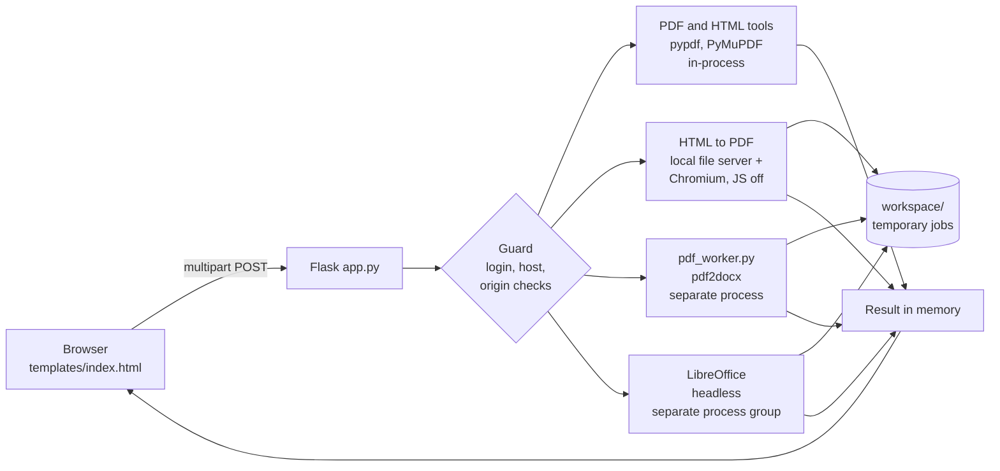

# Personal Tools

A self-hosted web app for everyday document jobs: merge PDFs, merge HTML, convert HTML, Word and PDF files in both directions, compress PDFs, and pull out pages. Everything runs on your own computer. Files are processed in memory or in short-lived temporary folders and deleted after each job.

It grew out of a handful of small command-line scripts (merge, compress, share, output) and now wraps them in a browser interface with proper input checks, limits and sandboxing.

---


## Contents

- [Features](#features)
- [Quick start](#quick-start)
- [Using the tools](#using-the-tools)
- [Configuration](#configuration)
- [Sharing with friends](#sharing-with-friends)
- [Security model](#security-model)
- [Architecture](#architecture)
- [Project structure](#project-structure)
- [API reference](#api-reference)
- [Limits](#limits)
- [Troubleshooting](#troubleshooting)
- [Deployment notes](#deployment-notes)
- [Roadmap](#roadmap)
- [Contributing](#contributing)

---

## Features

| Tool | What it does | Engine |
|---|---|---|
| **Merge PDFs** | Combine PDFs. Reorder by dragging, with arrows, or sort by filename (`1, 2, 10`). | pypdf |
| **Merge HTML** | Join `.html` / `.htm` files and ZIPs of them into one page. Sort by name, by `_YYYYMMDD` date in the name, or manually. Output is one clean document or plain joined text. | built in |
| **HTML to PDF** | Render a page, or a ZIP with its images and styles, to an A4 PDF. Several files are merged first. | Chromium via Playwright |
| **PDF to Word** | Convert a PDF to an editable `.docx`. Works best on PDFs with real text. | pdf2docx |
| **Word to PDF** | Convert `.docx`, `.doc`, `.odt` or `.rtf` to PDF. | LibreOffice |
| **Compress PDF** | Two methods: *Small* redraws pages as JPEG with adjustable DPI and quality; *Lossless* keeps text and vectors. Shows how much smaller the result is. | PyMuPDF |
| **Extract pages** | Keep only chosen pages in the order given, such as `1-3, 5, 8-10`. | PyMuPDF |

Also included:

- Light and dark themes, a keyboard-friendly layout, and a phone-friendly layout.
- A live readout of the temporary workspace size in the page footer.
- An optional login for when you share the app.
- A hardened server: see [Security model](#security-model).

---

## Quick start

**Requirements**

- Python 3.9 or newer (3.10+ recommended, see [Troubleshooting](#troubleshooting))
- LibreOffice, only for **Word to PDF**
- About 400 MB of disk space for the Chromium download, only for **HTML to PDF**

Tested on macOS (Python 3.9) and Linux (Python 3.12). Windows has not been tested.

```bash
git clone https://github.com/aarnav2425/Personal-Tools-.git
cd Personal-Tools-

python3 -m venv .venv
source .venv/bin/activate                 # Windows: .venv\Scripts\activate

python3 -m pip install -r requirements.txt
python3 -m playwright install chromium    # for HTML to PDF
```

Install LibreOffice for Word to PDF:

```bash
brew install --cask libreoffice           # macOS
sudo apt install libreoffice-writer       # Debian / Ubuntu
# Windows: download the installer from libreoffice.org
```

Run it:

```bash
python3 app.py
```

Open <http://127.0.0.1:5000>. Stop the server with `CTRL+C`.

> The app listens on `127.0.0.1` only, so nothing else on your network can reach it unless you choose to share it.

---

## Using the tools

1. Pick a tool in the left rail (a row of chips on phones).
2. Drop files onto the sheet, or click it to choose files.
3. Adjust options if the tool has any.
4. Press the action button, then download the result.

| Tool | Options |
|---|---|
| Merge PDFs | **Order of files:** as listed, or by filename |
| Merge HTML | **Order:** by filename, by date in name, or as listed. **Result:** one clean HTML document, or plain joined text |
| HTML to PDF | **Order** (only matters when several files are given) |
| Compress PDF | **Method:** small or lossless. **Detail:** 36 to 300 DPI. **Image quality:** 1 to 95 |
| Extract pages | **Pages to keep**, e.g. `1-3, 5, 8-10` |
| PDF to Word, Word to PDF | none |

**Notes on results**

- *Compress, Small mode* turns every page into an image, so text can no longer be selected. If the result is not smaller than the original, the page says so and suggests the other method.
- *HTML to PDF* runs with JavaScript off for safety. Pages that build their content with scripts will come out incomplete.
- *PDF to Word* does no text recognition (OCR). Scanned pages stay as pictures.
- *Merge HTML* keeps any `<script>` tags from the inputs. They will run when you open the merged file, so only merge pages you trust.

---

## Configuration

Settings are environment variables, set when you start the app.

| Variable | Default | Purpose |
|---|---|---|
| `APP_PASSWORD` | *(unset)* | When set, every page and API call requires a login. Any username works; the password must match. |
| `ALLOWED_HOSTS` | *(unset)* | Extra host names the app answers to when **no** password is set. Comma separated. An entry starting with a dot, such as `.example.com`, matches all subdomains. |

Examples:

```bash
APP_PASSWORD='a-long-passphrase' python3 app.py
ALLOWED_HOSTS=.mytunnel.example python3 app.py
```

Constants you can change near the top of `app.py`:

| Constant | Default | Meaning |
|---|---|---|
| `MAX_CONTENT_LENGTH` | 200 MB | Largest upload accepted |
| `MAX_PAGES` | 2000 | Page limit for merge, compress, extract and PDF to Word |
| `SLOTS` | 2 | Heavy jobs allowed at once |

The port is the last line of `app.py` (`port=5000`). On macOS, port 5000 can be taken by AirPlay Receiver; change it to 5001 if you see "address already in use".

---

## Sharing with friends

By default only your own computer can open the app. To let others use it, put a tunnel in front of it **and set a password**.

```bash
# terminal 1
APP_PASSWORD='a-long-passphrase' python3 app.py

# terminal 2: gives you a public https link
brew install cloudflared
cloudflared tunnel --url http://localhost:5000
```

Send friends the link and the password. Tips:

- Use a long passphrase. There is no lockout after failed attempts.
- Keep your computer awake while sharing (`caffeinate -i` on macOS).
- Tailscale is a good alternative: friends join your private network and the app is never exposed to the open internet.
- Anyone with the password can run conversions on your machine, so share only with people you trust.

---

## Security model

The app opens files from the browser, and some of those files can be hostile. These protections are built in and covered by tests:

| Risk | Protection |
|---|---|
| Reading local files through HTML to PDF (`file://` iframes and images) | Chromium renders with JavaScript off, and all requests are blocked except those to a throwaway local server that serves only the job's folder |
| Requests from a rendered page to internal services | Same network lockdown |
| ZIP bombs (in ZIP uploads and inside `.docx` / `.odt`) | Caps of 1,000 files and 200 MB unpacked |
| Word documents that pull in outside files or carry macros | Pre-scan rejects external links, `INCLUDETEXT` / `INCLUDEPICTURE` fields, linked sections, DDE and macros. Ordinary web hyperlinks are allowed |
| Slow or crashing converters | PDF to Word and Word to PDF run as separate processes with time limits (180 s and 120 s). Timeouts kill the whole process group so nothing lingers |
| Memory and CPU exhaustion | Upload limit, page limit, pixel limit for rasterizing, and at most 2 heavy jobs at once |
| Other websites using your local app (CSRF) | Cross-site and foreign-origin POSTs are refused |
| DNS rebinding | Only `localhost` and `127.0.0.1` are accepted as host names unless you allow more |
| Information leaks | The disk readout shows size only, never paths. Error messages are generic. Secret-looking environment variables are stripped before running converters |
| Browser-side attacks | Content Security Policy, `X-Frame-Options`, `nosniff`, no caching, escaped filenames |
| Other users on the same computer | The workspace folder is private (mode 700), and the app refuses to start if it is a symlink |

**What is not covered**

- The Word-document scan is a safety filter, not a guarantee. Keep LibreOffice updated.
- The PDF and Office libraries parse untrusted files, and bugs in them appear from time to time. Keep dependencies current and run `pip-audit -r requirements.txt` regularly.
- The built-in Flask server is for personal use. For anything public, use a production server and rate limiting.
- The password uses HTTP Basic authentication. Use it only over HTTPS (a tunnel provides that) or on localhost.

Please report security issues privately to the repository owner rather than in a public issue.

---

## Architecture



- Light tools work entirely in memory and return the result in the same request.
- Heavy tools use a throwaway folder inside `workspace/`, which is deleted when the job ends, whether it succeeds or fails. The whole folder is also emptied each time the app starts.
- A semaphore keeps at most two heavy jobs running at once; extra requests wait up to 10 seconds, then get a "busy" message.

---

## Project structure

```
Personal-Tools-/
├── app.py               Flask server: routes, security checks, limits, cleanup
├── pdf_worker.py        Runs pdf2docx in its own process (timeout + isolation)
├── requirements.txt     Python dependencies
├── README.md            This file
├── .gitignore           Ignores workspace/ and __pycache__/
├── templates/
│   └── index.html       The whole interface: markup, styles and script
└── workspace/           Created at start-up; temporary job folders live here
```

Keep `pdf_worker.py` next to `app.py`, and keep the folder named `templates`.

---

## API reference

Every tool is a plain `POST` that returns the result file, so you can script them without the browser. On errors the response is JSON: `{"error": "..."}`.

| Endpoint | Form fields | Returns |
|---|---|---|
| `POST /api/merge-pdf` | `files` (2 or more), `sort` = `manual` \| `natural` | `merged.pdf` |
| `POST /api/merge-html` | `files` (`.html`, `.htm`, `.zip`), `sort` = `natural` \| `date` \| `manual`, `structure` = `valid` \| `raw` | `merged_output.html` |
| `POST /api/html-to-pdf` | `files`, `sort`, `merge_first` = `1` (optional) | `output.pdf` |
| `POST /api/pdf-to-word` | `file` | `converted.docx` |
| `POST /api/word-to-pdf` | `file` (`.docx`, `.doc`, `.odt`, `.rtf`) | `converted.pdf` |
| `POST /api/compress-pdf` | `file`, `mode` = `raster` \| `lossless`, `dpi` (36 to 300), `quality` (1 to 95) | `compressed.pdf` |
| `POST /api/split-pdf` | `file`, `pages` such as `1-3,5,8-10` | `extracted.pdf` |
| `GET /api/disk-usage` | none | `{"bytes": 0}` |

Examples:

```bash
curl -F files=@a.pdf -F files=@b.pdf -F sort=natural \
     http://127.0.0.1:5000/api/merge-pdf -o merged.pdf

curl -F file=@report.pdf -F mode=raster -F dpi=120 -F quality=60 \
     http://127.0.0.1:5000/api/compress-pdf -o small.pdf

# with a password set
curl -u me:'a-long-passphrase' -F file=@notes.docx \
     http://127.0.0.1:5000/api/word-to-pdf -o notes.pdf
```

Status codes: `400` bad input, `401` login needed, `403` blocked cross-site request, `413` upload too large, `429` server busy, `501` a required program is missing, `504` conversion timed out.

---

## Limits

| Limit | Value |
|---|---|
| Upload size | 200 MB |
| Pages per PDF job | 2,000 |
| ZIP contents | 1,000 files, 200 MB unpacked |
| Rasterized page size | about 120 million pixels at the chosen DPI |
| Heavy jobs at once | 2 |
| HTML to PDF page load | 30 s |
| PDF to Word | 180 s |
| Word to PDF | 120 s |

Compressing a very long PDF in *Small* mode takes a while, because every page is redrawn.

---

## Troubleshooting

| Symptom | Cause and fix |
|---|---|
| PDF to Word says `pdf2docx is not installed` (501) | Install into the same Python you run the app with: `python3 -m pip install -r requirements.txt` |
| PDF to Word fails with `'Rect' object has no attribute 'get_area'` | Old `pdf2docx` with a newer PyMuPDF. The app patches this automatically inside `pdf_worker.py`. If you see it, make sure you are running the latest `pdf_worker.py` |
| Word to PDF says `LibreOffice not found` (501) | Install LibreOffice (see [Quick start](#quick-start)) and restart the app. On macOS the app also checks `/Applications/LibreOffice.app` |
| Word to PDF says the document links to outside files | The safety scan rejected it. Open it in Word, remove linked files or fields and macros, save a copy, and try again |
| HTML to PDF fails on a fresh install | Run `python3 -m playwright install chromium` |
| HTML to PDF output is missing content | The page depends on JavaScript, which is disabled on purpose |
| "Address already in use" on port 5000 | On macOS, turn off AirPlay Receiver in System Settings, or change the port in the last line of `app.py` |
| Page shows 400 when opened through a tunnel | Set `APP_PASSWORD`, or add the tunnel name to `ALLOWED_HOSTS` |
| 429 "Server busy" | Two heavy jobs are already running. Wait a few seconds and retry |
| `pip` installs an older `pdf2docx` on Python 3.9 | Expected: newer releases need Python 3.10+. Upgrading Python (`brew install python@3.12`) removes the need for the compatibility patch |

Server errors are logged in the terminal where you started the app.

---

## Deployment notes

- **Your own computer plus a tunnel** is the simplest way to share: see [Sharing with friends](#sharing-with-friends).
- **Small server:** run it in a container or directly on a VM with at least 2 GB of RAM, with Chromium and LibreOffice installed, behind a reverse proxy with HTTPS and `APP_PASSWORD` set. Use a production WSGI server such as Gunicorn instead of `python3 app.py`.
- **Vercel and similar serverless hosts are a poor fit.** Request bodies are capped at a few megabytes, LibreOffice cannot be installed there, and Chromium is hard to fit in the function size limit.
- **Free hosting tiers** usually have too little memory for Chromium and LibreOffice.

---

## Contributing

Issues and pull requests are welcome. Before opening a pull request:

1. Run the app and try the tool you changed in the browser.
2. Run `bandit -r app.py pdf_worker.py` and `pip-audit -r requirements.txt`.
3. If you add an endpoint, apply the same safeguards as the others: the `@limited` decorator for heavy work, size and page checks, and generic error messages.

